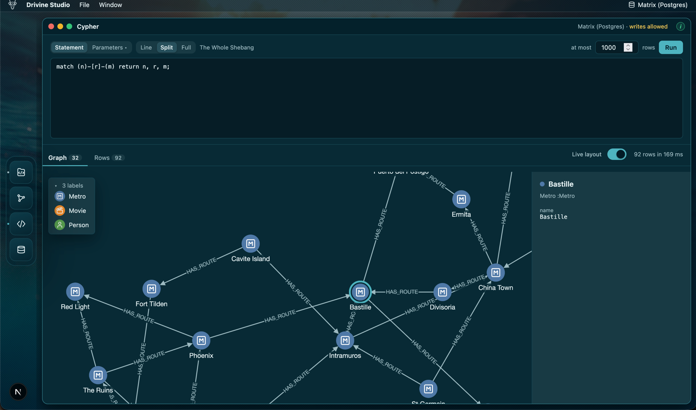

<a href="https://drivine.org/"></a>

# Drivine Studio

Browse a [Drivine](https://github.com/liberation-data) model, load its views and fragments as `loadAll` does, and
see what came back as a graph; run Cypher, and see it as a graph or as rows. By default the studio reads and never
writes: a connection can be set to allow writes from the Cypher window, and the Canvas only ever reads.

The browser app talks only to this app's own server, which connects to the databases with Drivine (TypeScript). The
same build runs from `npm start`, as a desktop app in Electron, and is meant to run in a container too.



*Cypher on Postgres, compiled to SQL by Drivine: the metro network from [Rock ’n’ Roll Traffic Routing, with Neo4j](https://liberation-data.com/saxeburg-series/2018/11/28/rock-n-roll-traffic-routing.html), now on any store. The station chosen is shown beside it.*

## Model files

Each Drivine library writes a module's model as `.drivine/model.json`, beside its build file, when it builds: its
fragments, relationship fragments and views, and how each is stored. The
[format](https://github.com/liberation-data/drivine-cypher-spec/tree/main/model) is shared by the three libraries.

The Catalogue's Folders sheet names the folders the studio looks in: each, and the folders in it, for model files,
leaving out those a build fills (`node_modules`, `build`, `target` and the like). A model file may be named itself.
`DRIVINE_STUDIO_MODELS` names more, separated as `PATH` is. The studio keeps the rest in `models.json` in its home.

It reads the files afresh for each load, so a model the build has just written is the one loaded. Every module's
entries are merged by id. An entry the code no longer declares is greyed out, as the store may still hold it; an id
current in one module and removed in another, as when a class moves, is the current one.

## Loading

Drag a view or fragment to the Canvas, and the studio loads it on the connection in use. Drivine (TypeScript) writes
the Cypher, from Drivine's own models of the file's entries and its own query DSL: the Cypher `loadAll` runs for the
query, which the Canvas shows, and opens in the Cypher window. Conditions are on the root's properties, or on the
nodes a relationship leads to, that one of them meets them or that none does; the roots are ordered by a property of
the root, and limited.

What comes back is drawn as a graph. A node is told apart by its fragment's id, and one whose fragment has none by
all it holds. A temporal value in a condition goes over Bolt as a Bolt temporal value, as drivine4j stores one, and to
FalkorDB as text.

## Icons

Each label in a graph is drawn with an icon from [Lucide](https://lucide.dev), found in this order:

1. **The one you chose.** Press a label in the graph's legend, or in Settings, to choose another, or none, or
   Automatic to have it found again. An icon is a label's: a node's first label, the one it is told by, so a choice
   shows on the Canvas and in the Cypher window alike, for every model and connection with the label. The studio
   keeps your choices in `icons.json` in its home.
2. **A common word in the label.** About eighty words, such as Person, Organization, Issue, Order and Note, each
   with its icon, and the words you add in Settings. The label's words are looked up whole, then each from the last,
   in your words first, so `GithubPerson` is a person, `SampleDocNode` a document, and a word of yours can give one
   of the built-in words another icon.
3. **The nearest icon by meaning.** A small local model, `all-MiniLM-L6-v2` (23 MB, quantized, on the CPU),
   compares the label's words with each icon's name and tags, and takes the nearest. The icon is used only when it
   is near enough: below that, the model was as often wrong as right in a test of sixty labels, and the node is drawn
   plain. An icon of one particular thing, such as a cigarette, a rat or a phone, is taken only for a label that names
   it, as the model would give one to Patient, Disease and Plan; for other labels the next nearest is taken. You can
   add icons of your own to that list in Settings.

**Icons** in Settings (Drivine Studio ▸ Settings…, ⌘, or Ctrl+,) shows every label in the graphs of the connections
that are up, and every label with an icon chosen, with its icon and why it has it: chosen, a common word (and which),
the model's (and how near), or none. A label with none has the model's nearest few icons beside it, to choose one with
a click. Your own common words and icons taken only by name are kept in `icons.json` with your choices, as
`{ labels, words, onlyByName }`; the built-in lists are shown beside them, and are changed only in the studio's code.
Try a Label shows what a label you type would get, and why, with the model's nearest icons and how near each is.

The model is downloaded once, the first time a label needs it, to `models` in the studio's home; offline before then,
labels get their chosen and common-word icons alone, and the download is tried again a minute later. The icons' own
vectors are in the repository, made by `npm run icon-vectors` after an upgrade of Lucide or the model.
`npm run test:icons` runs the model over sixty labels with the icons that would be right for them, and fails on a wrong
icon, or on fewer right than before: run it after a change to the model, the common words or the icons taken only by
name.

## Connections

Connections, the first section of Settings (Drivine Studio ▸ Settings…, ⌘, or Ctrl+,; or Connections… in the
connection menu at the end of the menu bar), adds, tests, changes and removes the databases the studio reads: Neo4j, Memgraph, Neptune,
FalkorDB, Postgres and Oracle. Each may be set to allow writes from the Cypher window: see Allowing writes. The studio keeps them in `connections.json` in `~/.drivine-studio`, or in
`DRIVINE_STUDIO_HOME`. The file holds passwords, so the studio writes it readable by its owner alone; the browser
is only ever told whether a connection has one.

On Postgres and Oracle, the connection names the graph as well as the database: the graph names its tables,
`<graph>_node` and `<graph>_edge`, and is `drivine` unless named, as in Drivine. A test reads the graph's nodes, so
it says when the tables are not there. The studio makes no tables: an application using Drivine makes them.

Drivine's own environment variables, as an application reads them (`DATABASE_TYPE`, `DATABASE_HOST`,
`DATABASE_PORT`, `DATABASE_USER`, `DATABASE_PASSWORD`, `DATABASE_NAME`, `DATABASE_DEFAULT_GRAPH_PATH`), add one more
connection, which the studio cannot change: so a container needs no file. `DRIVINE_STUDIO_CONNECTION_NAME` names it.

## Cypher

The Cypher window runs a statement on the connection in use, with parameters as a JSON object, and shows what came
back as a graph, when there are nodes in it, and as rows. It reads 1000 rows unless told otherwise, and at most
10,000. ⌘↵ runs it.

The editor draws Cypher in colour, and completes labels and relationship types after a colon, property keys after a
dot or in a map, and Cypher's own words. The names are the connection's graph's, read only: on Neo4j and FalkorDB
from what they keep (`db.labels()` and the others), on Memgraph and Neptune from a sample of 10,000 nodes and
relationships, and on Postgres and Oracle every label and type from the graph's tables, and property keys from a
sample of them, so a key on only a few nodes may not be offered. The studio keeps them in the browser, per
connection, and reads them again when the connection is chosen, after a statement that wrote, and when the studio
comes back to the front, in the browser or the app, a minute or more since.

A graph of up to 300 nodes can be drawn in 3D as well as 2D, with the switch above it; a bigger one is drawn in 2D,
and the choice is kept for the next small one. In 3D a click focuses a node and its neighbours, the legend's
checkboxes fade a label's nodes, and an icon is chosen in the 2D legend.

By default the studio never writes. Over Bolt (Neo4j, Memgraph, Neptune), a statement runs in a read session, whose
transaction the database will not let write, and which the studio rolls back all the same. On FalkorDB, which has no
transactions, it runs as a read-only query, which FalkorDB will not let write. A procedure that opens transactions of
its own, as some of APOC's do, is beyond both: give the studio a user that may only read, and that is the whole
guarantee.

On Postgres and Oracle, Drivine (TypeScript) compiles the Cypher to SQL over the graph's tables, with the compiler a
`PersistenceManager` compiles a Cypher statement with there: what it takes, and how its results can differ from a
graph engine's, is in Drivine's README, under Cypher on Oracle and Postgres. Drivine gives a node there as its
properties alone, so the studio compiles each item of the `RETURN` to come back whole, a node with its id and labels
and a relationship with its type and ends, and draws them as it draws a graph engine's: `MATCH
(p:Person)-[r:ACTED_IN]->(m) RETURN p, r, m` is a graph, and `RETURN p.name` rows. A path comes back whole too. A
statement that writes (`CREATE`, `MERGE`, `SET`, `REMOVE`, `DELETE`, `FOREACH`, in a `CALL { … }` or a `UNION` too) is
not sent; the rest runs in a transaction made read-only before anything runs in it, which the studio rolls back all
the same. Views and fragments are not loaded on them yet: Drivine loads them with SQL of its own, not Cypher.

### Allowing writes

A connection's **Allow writes** setting, in Settings under Connections, lets a statement run in the Cypher
window write. It is off unless turned on, and kept in `connections.json` with the rest of the connection; the
environment's connection never allows writes. The Cypher window says, above what a statement gives back, that the
connection in use allows writes. The Canvas, its loads, a Bench run of saved queries and a connection's test only ever read, whatever the setting.

With it on, a statement in the Cypher window runs in a transaction that may write, and is committed: over Bolt, in a
write session; on FalkorDB, as a query that may write, which FalkorDB, having no transactions, has done once it
answers; on Postgres and Oracle, a statement that writes runs as Drivine compiles and runs it, as a
`PersistenceManager` does, in a transaction that is committed, and a statement that only reads runs as above. Beside
the rows, the window says what changed, as the database counts it: nodes and relationships created and deleted,
properties set, labels added and removed, from Neo4j's and Memgraph's summary counters and from FalkorDB's statistics.
Drivine gives no counts on Postgres and Oracle, so there the window says only that the statement ran, and what it
returns comes back as Drivine gives it, a node as its properties alone: a later `MATCH` draws it.

The server answers only the studio's own pages, on `localhost`: a page of another site, or one whose name has been
pointed at this machine, is refused. `DRIVINE_STUDIO_ALLOWED_HOSTS` names the hosts to answer to in its place, as a
container behind a name of its own needs.

## Trying it

```sh
npm install
npm run dev                                    # http://localhost:5187
```

Add a connection in Settings, under Connections, and a folder with model files in the Catalogue's Folders sheet: a
drivine4j checkout, say, whose `drivine4j-sample` has one. Then drag a view to the Canvas, or run Cypher in the
Cypher window.

`npm run build && npm start` serves the standalone build on the same port. `npm test` runs the tests, and
`npm run test:db` the ones against Neo4j, FalkorDB, Postgres and Oracle, in Docker, the sample domain's loads among
them.

## Desktop app

The desktop app runs the same standalone server inside Electron and opens a window on it. Its log is
`drivine-studio-electron.log` in the system's temporary directory (on a Mac, Drivine Studio ▸ Open Log File).

```sh
npm run electron            # build, then open the app
npm run electron:watch      # the dev server, with the app on it and its dev tools open
npm run package:mac         # an unpacked app in dist/; package:mac:dmg, package:win, package:linux and package:all too
```

The packages are unsigned, and use Electron's default icon for now.

### Install it yourself

There are no downloads to install yet: build the app on the machine that will run it. A downloaded app is marked by
the browser that fetched it, and macOS's Gatekeeper and Windows's SmartScreen stop an unsigned one; an app built here
was never downloaded, so it opens like any other.

You need git and Node.js 22 or later. Then:

```sh
git clone https://github.com/liberation-data/drivine-studio.git
cd drivine-studio
npm ci
```

- **macOS:** `npm run package:mac` makes `dist/mac-arm64/Drivine Studio.app` on Apple silicon (`dist/mac/` on Intel).
  Drag it to Applications. It is signed for this Mac alone, which is all a Mac needs to run what it built.
- **Windows:** `npm run package:win` makes `dist\win-unpacked\Drivine Studio.exe`, to run where it is;
  `npm run package:win:installer` makes an installer in `dist\` as well. Build it on Windows.
- **Linux:** `npm run package:linux:appimage` makes an AppImage in `dist/`. Run `chmod +x` on it, then run it. Build it
  on Linux.

The app serves the studio on port 5187, as `npm run dev` does, so stop a dev server before opening it, or open it from
a terminal with `PORT` set to another port. To update, `git pull`, `npm ci` and package again.

## Where it is going

- Model files read straight from GitHub, with nothing built.
- Conditions on a relationship's own properties, and along a path.
- Loading views and fragments on Oracle and Postgres, with the SQL Drivine (TypeScript) loads them with.
- A container image, from the same standalone build.

## License

Apache-2.0
